<p align="center">
  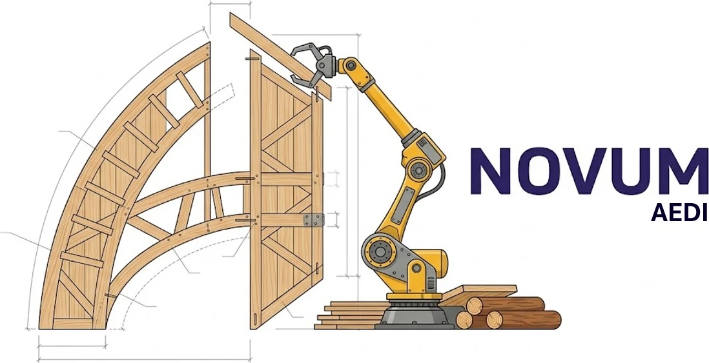
</p>

<h1 align="center">Flux logistiques, implantation <i>lean</i> et jumeau numérique<br>d'une usine de construction hors site</h1>

<p align="center">
  <b>Challenge Imagine &amp; Make 2026 · Centrale Lille · défi Avelis · Bloc 3 « Flux logistiques et données »</b><br>
  Équipe NOVUM AEDI · une semaine, du 2 au 6 novembre 2026
</p>

<p align="center">
  <a href="https://github.com/david-lansade/novum-aedi/actions/workflows/python-app.yml"></a>
  
  
  
</p>

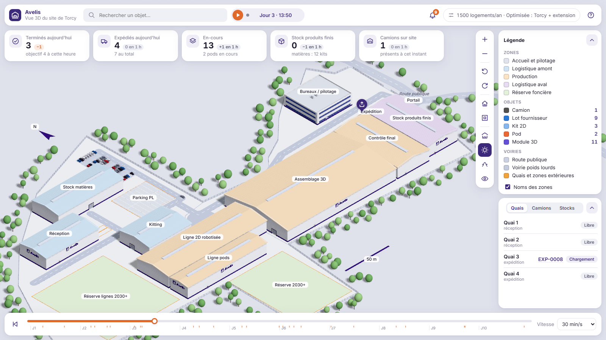

---

## Sommaire

1. [Le contexte : un challenge d'une semaine](#1-le-contexte--un-challenge-dune-semaine)
2. [Notre réponse en une image](#2-notre-réponse-en-une-image)
3. [Résultats clés](#3-résultats-clés)
4. [Visite guidée en captures](#4-visite-guidée-en-captures)
5. [Installation et lancement](#5-installation-et-lancement)
6. [Organisation du dépôt](#6-organisation-du-dépôt)
7. [Méthode, hypothèses et limites](#7-méthode-hypothèses-et-limites)
8. [L'équipe](#8-léquipe)

---

## 1. Le contexte : un challenge d'une semaine

**Imagine & Make** est un challenge de Centrale Lille : en une semaine, des équipes d'étudiants
répondent à un problème industriel réel posé par une entreprise partenaire, du
diagnostic jusqu'au démonstrateur qui fonctionne.

En 2026, le partenaire était **Avelis**, groupe français de **construction hors site** : des
logements fabriqués en usine sous forme de modules 3D (avec ossature, murs 2D et pods salle de
bain), puis transportés et posés sur chantier. Avelis veut passer d'une fabrication encore
largement artisanale à un **modèle industriel standardisé et robotisé**, capable de
**1 000 à 1 500 logements par an à l'horizon 2029**, sur son site de **Torcy (Saône-et-Loire)**.

Le défi consistait à concevoir la chaîne industrielle robotisée correspondante, **en définissant
la juste place de l'humain**. Il était découpé en trois blocs :

| Bloc | Thème |
|---|---|
| Bloc 1 | Conception des produits |
| Bloc 2 | Production robotisée |
| **Bloc 3** | **Flux logistiques et données**, le sujet de ce dépôt |

Le Bloc 3 couvre tout ce qui circule : camions fournisseurs, lots de matières, kits, pods,
modules, convois de livraison, et l'information qui les accompagne. Il était évalué sur
**cinq indicateurs officiels**, tous calculés et affichés par notre logiciel :

1. la **distance parcourue par un sous-ensemble** dans l'usine ;
2. les **surfaces de stockage rapportées à la cadence** ;
3. la **part des composants tracés de bout en bout** ;
4. le **délai entre un événement et son affichage** dans l'outil de pilotage ;
5. le nombre de **ruptures ou d'attentes** en simulation.

En cinq jours, l'équipe a produit trois logiciels qui fonctionnent ensemble, un rapport
scientifique de 15 pages (dossier [`rapport/`](rapport/)) et une démonstration sur une maquette
d'atelier, scannée en direct au téléphone.

## 2. Notre réponse en une image

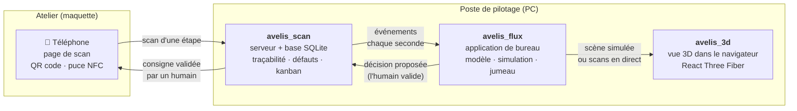

| Logiciel | Rôle | Technologies |
|---|---|---|
| [**`avelis_flux/`**](avelis_flux/) | Application de bureau. Dimensionne le site, compare trois implantations et deux schémas industriels, simule la production par événements discrets, montre la traçabilité de chaque module et porte le **jumeau numérique** alimenté par les scans. | Python, Tkinter, matplotlib, numpy. Moteur de simulation écrit à la main, sans SimPy. |
| [**`avelis_3d/`**](avelis_3d/) | **Vue 3D** du site dans le navigateur : bâtiments, camions, lots, pods et modules qui se déplacent exactement comme dans la simulation, sélection d'un objet et chronologie de sa traçabilité. | React, Three.js, React Three Fiber, Vite. Livrée construite dans `dist/`, sans Node ni Internet. |
| [**`avelis_scan/`**](avelis_scan/) | **Application de scan terrain** : un serveur sur le PC, une page web sur le téléphone. Chaque geste de l'atelier est enregistré : étapes, défauts, lots bloqués, kanban, consignes. | Python (bibliothèque standard), SQLite, HTML/JS. QR codes et puces NFC. |

Le détail de chaque bouton est décrit dans [`FONCTIONNALITES.md`](FONCTIONNALITES.md), le format
des données échangées dans [`avelis_flux/ARCHITECTURE_DONNEES.md`](avelis_flux/ARCHITECTURE_DONNEES.md).

## 3. Résultats clés

À 1 500 logements par an, en usine unique (valeurs du modèle et de la simulation, graine 42) :

| Question | Ce que montrent nos modèles |
|---|---|
| **Où est le goulot ?** | L'**assemblage 3D** : 16 h de travail par module imposent **12 baies chargées à 85 %**, pour un takt de 93,9 min. La ligne 2D, la ligne pods et le kitting tiennent le takt avec une seule unité. |
| **Quelle implantation ?** | Notre implantation **optimisée** réduit la distance d'un sous-ensemble de **15 %** (681 → 580 m), divise par deux la gamme des murs (343 → 177 m), économise **28 %** des distances en charge et supprime tout croisement de flux. Le débit, fixé par le goulot, reste à 99,3 % de l'objectif : l'implantation agit sur le gaspillage, pas sur la cadence. |
| **Le foncier suffit-il ?** | Le site actuel tient jusqu'à 1 800 logements par an ; au-delà, l'**extension** est nécessaire. Elle conditionne l'évolutivité plus que l'objectif 2029. |
| **Quelle traçabilité ?** | Avec une quinzaine de points de contrôle par module, la **RFID + IoT** trace **97,5 %** des modules en quelques secondes, le **QR code** manuel 71,5 % en 3 min, le **papier** 30,8 % avec 4,6 h de retard. Nous recommandons un marquage QR de chaque pièce et des portiques RFID aux cinq nœuds de flux. |
| **Usine unique ou satellites ?** | Cela dépend de la géographie de la demande. Usine unique pour une demande diffuse ou proche ; usine mère + unités d'assemblage proches des chantiers dès 900 à 1 100 logements par an pour une demande lointaine et concentrée, avec **70 % d'émissions de transport en moins**. |
| **Que vaut le jumeau numérique ?** | Sa prévision des fins de fabrication réduit l'erreur moyenne de **34 %** par rapport à une prévision naïve. Il isole un poste ralenti **dès trois passages**. Il ne décide jamais seul : il **propose**, un humain **valide**. |

La cohérence interne du modèle est vérifiée par la **loi de Little** (en-cours prédit 11,9 modules,
mesuré 11,2) et par la comparaison des taux de traçabilité simulés aux valeurs théoriques.

## 4. Visite guidée en captures

### Vue 3D du site (navigateur)

Chaque objet suit la trajectoire calculée par la simulation. Un clic sur un module ouvre sa fiche
(pod, kit 2D, lot, camion d'expédition) et la chronologie de ses points de contrôle, lus ou non.

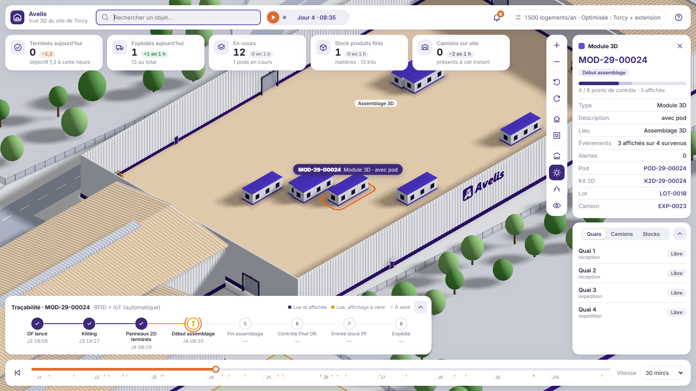

### Schéma de l'usine et flux (application de bureau)

Le plan du site, l'implantation choisie, les flèches de flux par gamme (avec leurs distances), les
objets animés et le **tableau de pilotage** : il n'affiche une alerte qu'à l'instant où la
technologie de traçabilité l'aurait réellement remontée.

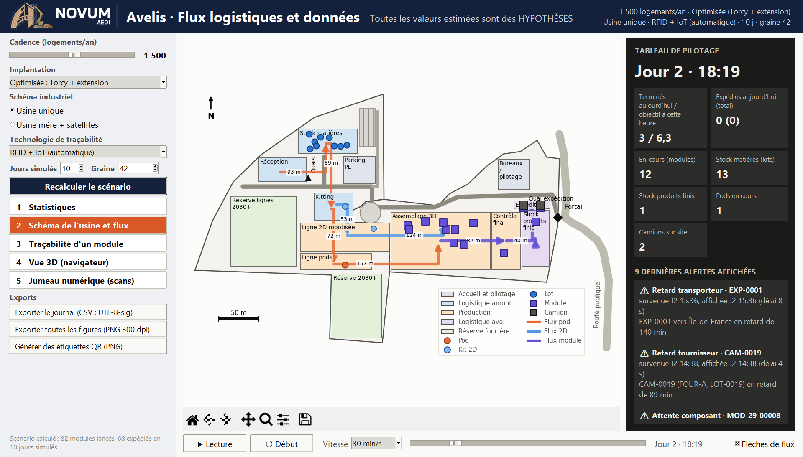

<details>
<summary><b>Mode suivi d'un module</b></summary>

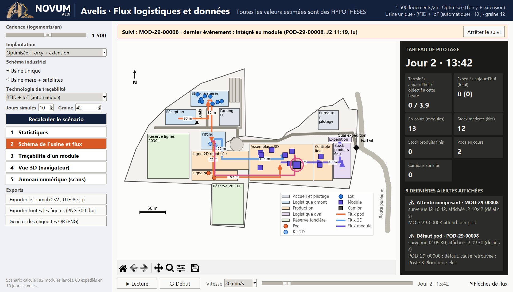

</details>

### Statistiques et réseau

Les six tuiles reprennent les indicateurs officiels du bloc. Les graphiques donnent le débit
journalier, l'utilisation des ressources, les en-cours, le Pareto des défauts, le coût des réseaux
et l'évolutivité du site.

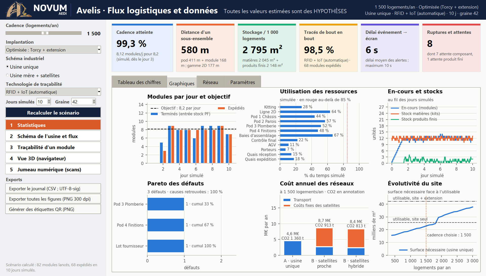

L'onglet **Réseau** compare l'usine unique et l'usine mère + satellites : cartes, coût par
logement selon la cadence, point de bascule et recommandation calculée. Chantiers et satellites
se modifient dans l'onglet **Paramètres**.

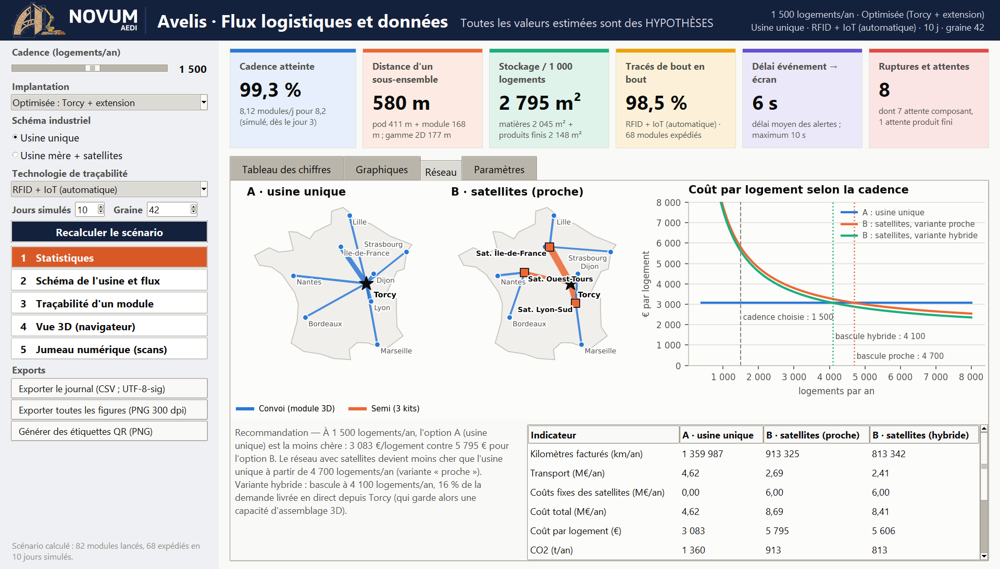

### Traçabilité d'un module

Généalogie complète **module ← pod ← lot ← camion ← fournisseur**, trace complète ou incomplète,
cause d'un défaut retrouvée ou non, QR code, et chronologie de tous les événements liés.

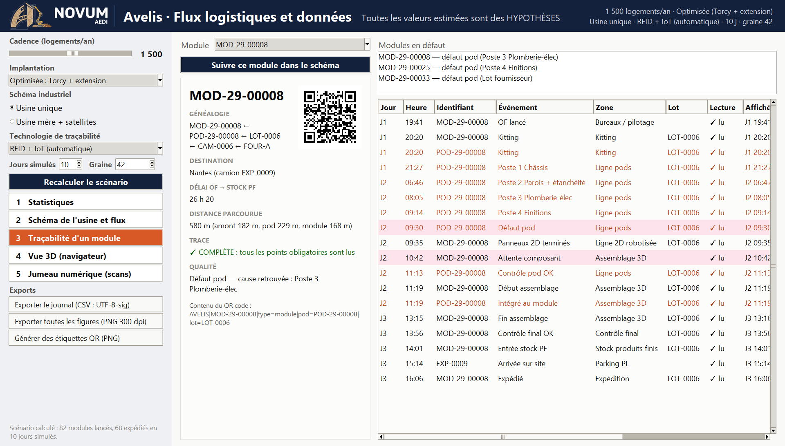

### Jumeau numérique alimenté par les scans

Le même plan, mais les pièces y sont placées **d'après les scans réels** de l'atelier. Le jumeau
compare l'atelier à la simulation, prévoit les fins de fabrication, détecte les étapes
anormalement lentes et propose des décisions qu'un humain valide ou ignore.

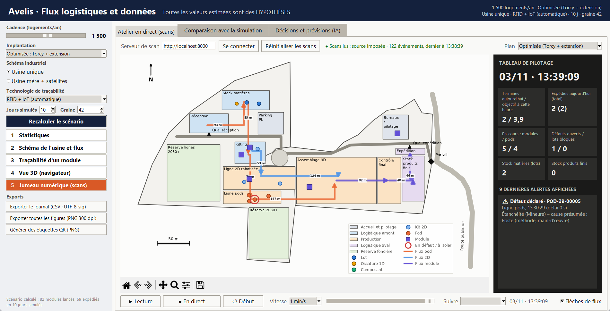

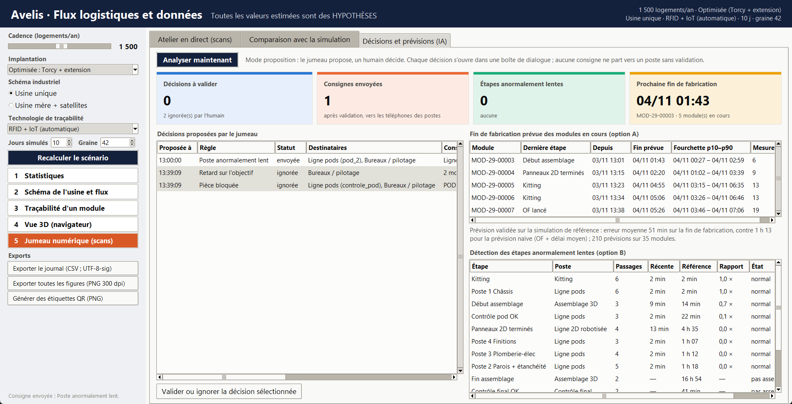

### Application de scan : téléphone et PC

<table>
  <tr>
    <td width="32%" valign="top">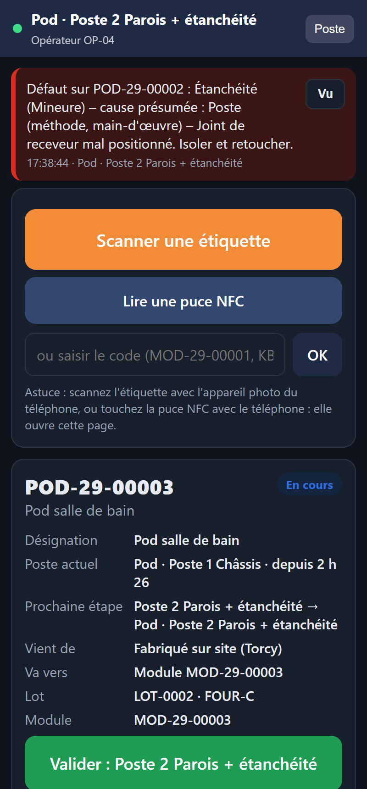</td>
    <td valign="top">
      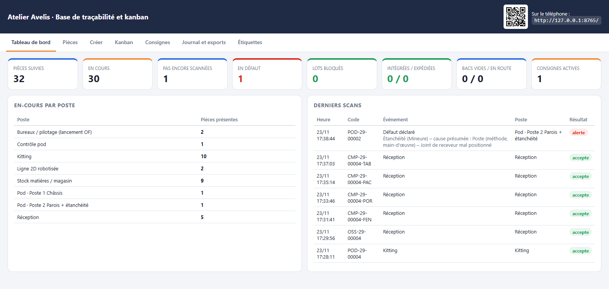
      <p>
        <b>Téléphone</b> (à gauche) : l'opérateur choisit son poste, scanne l'étiquette QR ou
        la puce NFC d'une pièce, voit sa gamme et valide l'étape. Une étape hors séquence est
        refusée (<i>poka-yoke</i>), un défaut bloque la pièce, et deux défauts sur un même lot
        bloquent tout le lot (<i>jidoka</i>). Les consignes du jumeau arrivent en haut de
        l'écran.
      </p>
      <p>
        <b>PC</b> (en haut) : tableau de bord, pièces, création de modules complets, kanban,
        consignes, journal et exports CSV, planche d'étiquettes QR à imprimer.
      </p>
    </td>
  </tr>
</table>

## 5. Installation et lancement

### Prérequis

- **Python 3.10 ou plus récent**, avec Tkinter (inclus sous Windows et macOS ; sous Linux :
  `sudo apt install python3-tk`).
- **Node.js 22 ou plus récent**, uniquement pour modifier la vue 3D. La version construite est
  fournie dans `avelis_3d/dist/`.

Le projet a été développé et testé sous **Windows 11**. Les commandes ci-dessous utilisent
`python` ; sous Windows, `py -3` fonctionne aussi.

```bash
git clone https://github.com/david-lansade/novum-aedi.git
cd novum-aedi
python -m pip install -r avelis_flux/requirements.txt
python -m pip install "qrcode[pil]"      # facultatif : QR codes et étiquettes
```

### Application de bureau et vue 3D

```bash
python avelis_flux/app.py
```

Réglez la cadence, l'implantation, le schéma industriel et la technologie de traçabilité, puis
cliquez sur **Recalculer le scénario**. Le bouton **4 Vue 3D** ouvre la scène dans le navigateur
par défaut, servie en local.

### Application de scan et jumeau numérique

```bash
python avelis_scan/serveur.py            # Windows : double-cliquer sur avelis_scan/demarrer.bat
```

- Sur le PC : `http://localhost:8000/pc` (onglet **Créer** › *Jeu d'essai* pour commencer).
- Sur le téléphone, connecté au même réseau : l'adresse et le QR code affichés dans la console.
  Sous Windows, `avelis_scan/autoriser_pare_feu.bat` (en administrateur) ouvre le port 8000.
- Dans l'application de bureau, la vue **5 Jumeau numérique** lit ce serveur chaque seconde.

Le mode d'emploi complet (scan à l'appareil photo, puces NFC, kanban) est dans
[`avelis_scan/LISEZMOI.md`](avelis_scan/LISEZMOI.md).

### Modifier la vue 3D

```bash
python avelis_flux/scene_3d.py --scene   # écrit une scène de développement (avelis_3d/scene.json)
cd avelis_3d
npm ci
npm run dev                              # serveur de développement
npm run build                            # reconstruit dist/, servi par l'application
```

### Tests

Chaque module embarque ses propres tests, lancés par exécution directe. Ils sont rejoués par
GitHub Actions à chaque commit.

| Commande | Contenu |
|---|---|
| `python avelis_flux/modele.py` | 28 tests du modèle de dimensionnement, puis chiffres clés à 1 500 logements/an |
| `python avelis_flux/simulation.py` | 22 tests de la simulation à événements discrets |
| `python avelis_flux/jumeau.py` | 9 tests du jumeau, sur un vrai atelier de scan en mémoire |
| `python avelis_flux/analyse_jumeau.py` | 6 tests de la prévision et de la détection des lenteurs |
| `python avelis_flux/decisions.py` | 7 tests des décisions (rien n'est envoyé sans validation) |
| `python avelis_flux/scene_3d.py` | 18 tests de la scène 3D et du serveur local |
| `python avelis_scan/tests_scan.py` | 19 tests des règles de scan, du NFC et du serveur |
| `cd avelis_3d && npm test` | 105 tests de la vue 3D (positions comparées à Python, trajectoires, interface) |
| `python avelis_flux/tests_interface.py` | Tests d'interface : 54 combinaisons, mise en page contrôlée à trois tailles d'écran (environ 15 min, ouvre la fenêtre) |

## 6. Organisation du dépôt

```
novum-aedi/
├── avelis_flux/                 Application de bureau (Python)
│   ├── app.py                   Interface Tkinter : 5 vues, exports
│   ├── modele.py                Hypothèses, dimensionnement, géométrie du site, réseau
│   ├── simulation.py            Moteur à événements discrets et usine simulée
│   ├── jumeau.py                Jumeau numérique : lecture des scans, comparaison
│   ├── analyse_jumeau.py        Prévision des fins de fabrication, détection des lenteurs
│   ├── decisions.py             Règles de décision, humain dans la boucle
│   ├── scene_3d.py              Export de la scène 3D et serveur local
│   ├── tests_interface.py       Tests de l'interface
│   ├── ressources/              Logos de l'équipe
│   ├── LISEZMOI.md              Mode d'emploi détaillé de l'application
│   └── ARCHITECTURE_DONNEES.md  Formats de données (scène 3D, scans, journal)
├── avelis_3d/                   Vue 3D (React, Three.js, React Three Fiber)
│   ├── src/                     Composants et calculs du rendu
│   ├── tests/                   Tests node --test, jeu de référence produit par Python
│   └── dist/                    Version construite, servie par l'application
├── avelis_scan/                 Application de scan (serveur, base SQLite, pages web)
│   ├── serveur.py, base.py      API et règles (traçabilité, défauts, lots, kanban)
│   ├── config.py                Postes, gammes, causes de défaut : à adapter à l'atelier
│   └── web/                     Pages du téléphone (scan.html) et du PC (pc.html)
├── rapport/                     Rapport scientifique LaTeX, figures et script de génération
├── images/                      Captures de ce README
└── FONCTIONNALITES.md           Description de chaque fonction des logiciels
```

## 7. Méthode, hypothèses et limites

- **Tout est hypothèse, sauf mention contraire.** Chaque valeur numérique métier est déclarée une
  seule fois, dans le dictionnaire `HYPOTHESES` en tête de [`avelis_flux/modele.py`](avelis_flux/modele.py),
  avec son unité, sa source et un commentaire. La marque **« A »** signale une donnée fournie
  par Avelis pour le challenge (cadence visée, surfaces du foncier), **« H »** une hypothèse de
  l'équipe, à remplacer par une donnée réelle. Toutes se modifient dans l'onglet **Paramètres**.
- **Aucune hypothèse n'a été ajustée pour atteindre un résultat attendu.** Les écarts aux ordres
  de grandeur visés sont affichés et expliqués, jamais corrigés en douce.
- **Résultats reproductibles.** Tout l'aléa passe par une graine : même graine, mêmes résultats.
  Les scénarios se comparent à graine égale.
- **Limites.** Les distances internes sont calculées en trajets orthogonaux entre centres de zones.
  La géométrie du site a été reconstituée d'après un plan. Le schéma satellites ne simule que
  l'usine mère. Les résultats valent par leur structure et leurs ordres de grandeur plus que par
  leurs décimales.
- **Rapport.** Le dossier [`rapport/`](rapport/) contient l'article LaTeX (à compiler avec biber,
  par exemple sur Overleaf), ses références et le script qui régénère toutes ses figures.
- **Développement assisté par IA.** Le code a été écrit avec l'assistant Claude Code (Anthropic),
  piloté phase par phase par l'équipe. L'équipe a fixé le cahier des charges et validé chaque
  étape. Les résultats ont été vérifiés par des tests écrits avant le code et des valeurs
  recalculées indépendamment. Cet usage est déclaré en annexe du rapport, comme l'exige le
  règlement du challenge. Les renvois « SPEC §… » dans les commentaires du code désignent ce
  cahier des charges interne, non publié.

## 8. L'équipe

**NOVUM AEDI**

- Ange BRILLOUT-HEURTIN
- Marin KOLEV
- David LANSADE
- Damien LEDOUX
- Raphael MAROLLE
- Oscar PECOURT

Merci à **Avelis** pour un sujet passionnant et aux organisateurs du challenge
**Imagine & Make** de Centrale Lille.

---

<sub>Projet pédagogique réalisé dans le cadre d'un challenge étudiant. Les chiffres présentés sont
des hypothèses de travail et ne reflètent ni les données ni la stratégie officielles d'Avelis.
Les noms et logos Avelis appartiennent à leur propriétaire.</sub>
